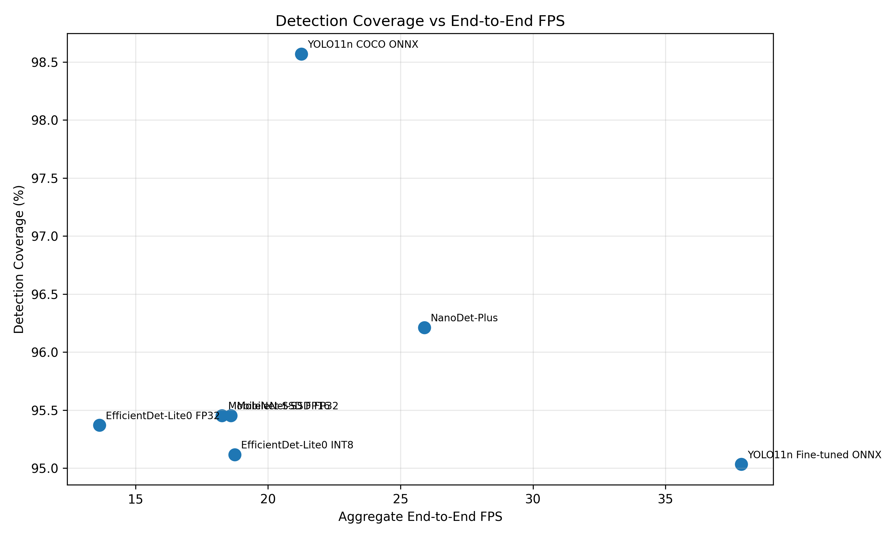
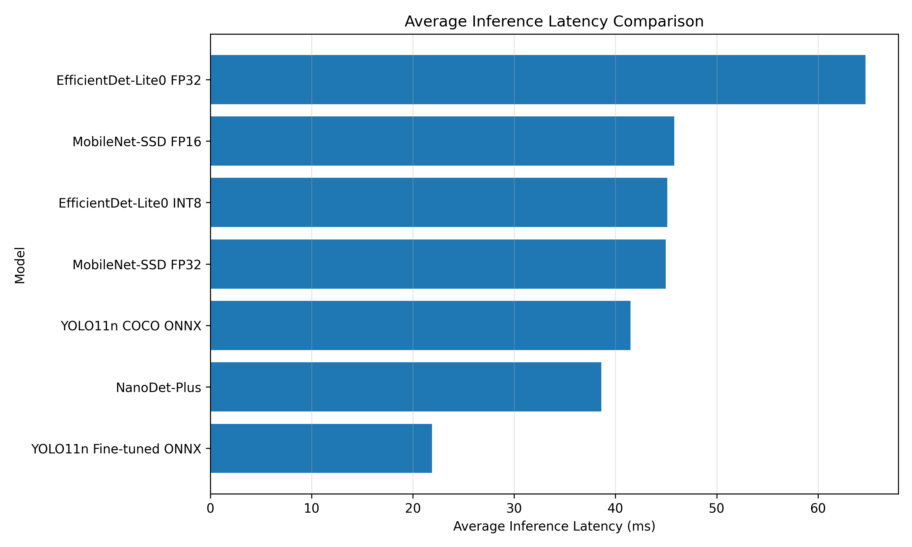
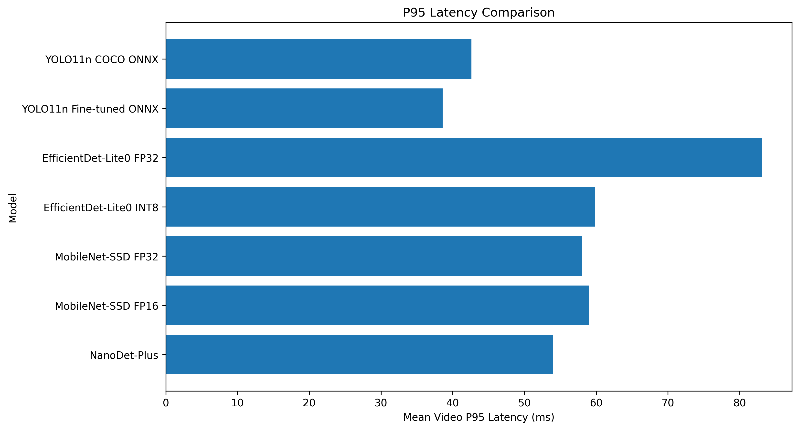

# Edge-Based Person Detection: Model Benchmarking and Performance Evaluation

## Overview

This project evaluates and compares lightweight object detection models for person detection in an edge-computing context.

The objective is to study the trade-offs between detection coverage, inference latency, processing speed, and computational resource usage across different model architectures and deployment formats.

The evaluation includes pretrained and fine-tuned YOLO models, EfficientDet-Lite0, MobileNet-SSD, and NanoDet-Plus.

## Models Evaluated

- YOLO11n COCO ONNX
- YOLO11n Fine-tuned ONNX
- YOLO11s ONNX
- EfficientDet-Lite0 FP32 and INT8
- MobileNet-SSD FP32 and FP16
- NanoDet-Plus
- YOLO11n NCNN

## Video Evaluation

All seven models in the main comparison were evaluated on the same video dataset:

- Total frames: **1,188**
- Number of videos: **5**
- Detection class: `person`

### Main Results

| Model | Detection Coverage (%) | Avg. Inference (ms) | Mean Video P95 (ms) | End-to-End FPS |
|---|---:|---:|---:|---:|
| YOLO11n COCO ONNX | 98.57 | 41.50 | 42.62 | 21.26 |
| YOLO11n Fine-tuned ONNX | 95.03 | 21.88 | 38.58 | 37.86 |
| EfficientDet-Lite0 FP32 | 95.37 | 64.70 | 83.12 | 13.64 |
| EfficientDet-Lite0 INT8 | 95.12 | 45.12 | 59.86 | 18.75 |
| MobileNet-SSD FP32 | 95.45 | 44.97 | 58.03 | 18.59 |
| MobileNet-SSD FP16 | 95.45 | 45.82 | 58.96 | 18.26 |
| NanoDet-Plus | 96.21 | 38.60 | 54.00 | 25.91 |

**Metric definitions:**

- **Detection Coverage:** Percentage of evaluated frames in which at least one person detection was produced. It is not mAP or conventional classification accuracy.
- **Average Inference:** Average model inference time per processed frame.
- **Mean Video P95:** Arithmetic mean of the five per-video P95 inference latency values. It is not a global P95 calculated over all frames.
- **End-to-End FPS:** Overall processing throughput, including the evaluation pipeline overhead.

### Main Observations

- YOLO11n COCO ONNX achieved the highest detection coverage at 98.57%.
- YOLO11n Fine-tuned ONNX achieved the highest end-to-end throughput at 37.86 FPS.
- NanoDet-Plus achieved 96.21% detection coverage at 25.91 FPS.
- EfficientDet-Lite0 INT8 reduced inference latency compared with its FP32 version, while maintaining similar detection coverage.
- MobileNet-SSD FP16 and FP32 achieved identical detection coverage in this evaluation.

## Model Benchmark

A separate benchmark was conducted to examine YOLO deployment formats and input resolutions.

### ONNX Benchmark

| Model | Image Size | Avg. Latency (ms) | P95 (ms) | Inference FPS | CPU (%) | RAM (MB) | Size (MB) |
|---|---:|---:|---:|---:|---:|---:|---:|
| YOLO11n | 320 | 9.28 | 12.01 | 105.63 | 38.69 | 102.99 | 10.05 |
| YOLO11s | 320 | 21.04 | 29.73 | 47.11 | 51.74 | 137.77 | 36.05 |
| YOLO11n | 416 | 15.36 | 20.51 | 64.26 | 50.61 | 121.29 | 10.08 |
| YOLO11n | 640 | 38.07 | 48.52 | 26.11 | 52.73 | 210.61 | 10.17 |

### Additional Deployment Measurements

| Model | Format | Image Size | Avg. Latency (ms) | P95 (ms) | FPS | CPU (%) | RAM (MB) | Size (MB) |
|---|---|---:|---:|---:|---:|---:|---:|---:|
| YOLO11n | ONNX | 320 | 35.24 | 39.03 | 28.08 | 70.52 | 340.56 | 10.05 |
| YOLO11n | NCNN | 320 | 42.71 | 47.52 | 23.20 | 100.00 | 359.16 | 9.98 |
| YOLO11n | NCNN | 320 | 39.56 | 42.66 | 25.03 | 100.00 | 336.75 | 9.95 |

**Benchmark note:** These measurements come from separate benchmark runs and protocols. They are reported independently and should not be averaged or treated as directly interchangeable.

## Visual Results

The following charts summarize the main video evaluation:

### Detection Coverage vs. End-to-End FPS



### Inference Latency Comparison



### P95 Latency Comparison



## Evaluation Methodology

The project uses video-based evaluation and separate model benchmarking.

The main video evaluation measures:
- Frames containing at least one person detection.
- Detection coverage across the evaluated frames.
- Average inference latency.
- P95 inference latency per video.
- Aggregate end-to-end processing throughput.

The separate model benchmark records:
- Input image resolution.
- Average and P95 latency.
- Inference FPS.
- CPU and RAM usage.
- Model file size.

## Limitations

- The video evaluation uses a limited dataset of five videos and 1,188 frames.
- Detection coverage is not equivalent to mAP. A complete ground-truth annotation for every evaluated video frame was not available for a full mAP calculation.
- Benchmark results depend on the measurement protocol and runtime configuration.
- Temperature measurements and separate preprocessing/inference/postprocessing timings were not collected for every model.
- No physical Raspberry Pi deployment or real-camera testing was performed.
- Hailo-8L deployment was not completed and is excluded from the reported results.
- NanoDet-Plus showed localization limitations in some detections; its coverage result should not be interpreted as proof of accurate bounding-box localization.

## Repository Structure

```text
person-detection/
│
├── results/
│   ├── charts/
│   │   ├── coverage_vs_fps.png
│   │   ├── latency_comparison.png
│   │   └── p95_comparison.png
│   │
│   ├── csv/
│   └── final/
│       ├── final_benchmark_summary.csv
│       └── final_video_summary.csv
│
├── README.md
└── .gitignore
```

Additional source code and evaluation scripts may be included in their respective project directories.

## Conclusion

The evaluation demonstrates that model selection for edge-based person detection involves a trade-off between detection coverage and processing speed.

YOLO11n COCO ONNX achieved the highest detection coverage in the video evaluation, while the fine-tuned YOLO11n model delivered the highest end-to-end throughput.

The results provide a comparative software-based evaluation of multiple lightweight detection approaches and highlight the importance of considering both detection performance and computational efficiency when selecting a model for edge deployment.